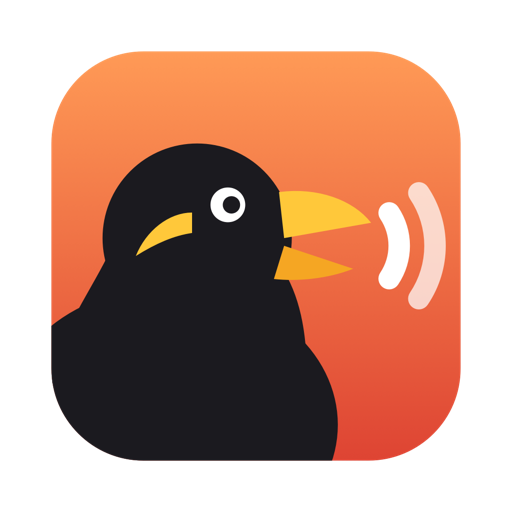
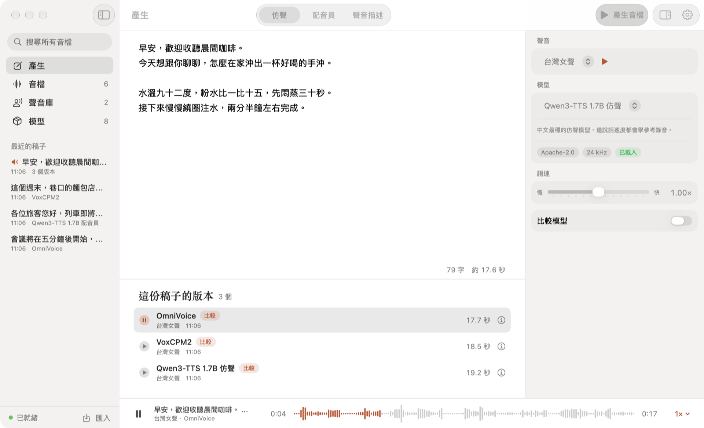

[繁體中文](../README.md) | **English**

# Myna (九官鳥)

A text-to-speech app for macOS. Write a script, pick a voice and a model, and Myna reads it into an audio file on your Mac. You can record ten seconds of your own voice for it to learn, use a built-in speaker, or describe the voice you want in a sentence.

The interface is in Traditional Chinese only for now. Scripts can be Chinese, English, Japanese or Korean, depending on the model.

- Speech is generated on your Mac. Scripts, recordings and audio files are never uploaded
- A catalog of 8 open-source speech models. You choose which to download
- Send one script to several models at once and compare the results side by side
- No Python install needed. The app bundles its own
- Requires Apple Silicon and macOS 14 or later (developed and tested on macOS 27)



## Models

Models are not bundled. You download them from the Models page; they live in the Hugging Face cache. I tested each one with the same Chinese sentence, transcribed the result back with a speech recognizer, and counted wrong characters.

| Model | Modes | Size | License | Error rate | Notes |
|---|---|---|---|---|---|
| Qwen3-TTS 1.7B Base | Clone | 4.5 GB | Apache-2.0 | 0% | Most stable for Chinese |
| Qwen3-TTS 1.7B CustomVoice | Speakers | 4.5 GB | Apache-2.0 | 0% | 9 built-in speakers, takes a style instruction |
| Qwen3-TTS 1.7B VoiceDesign | Describe | 4.5 GB | Apache-2.0 | 0% | |
| Qwen3-TTS 0.6B Base | Clone | 2.0 GB | Apache-2.0 | 0% | Lighter, less than half the memory |
| Breeze-TTS 2 | Clone, Describe | 4.6 GB | Research / non-commercial | 0% | Style instruction while cloning. **Not for commercial use** |
| VoxCPM2 | Clone, Describe | 3.2 GB | Apache-2.0 | 0% | 48 kHz |
| OmniVoice | Clone, Describe | 1.6 GB | Apache-2.0 | 0% | Fastest. The model controls speed itself |
| MOSS-TTS Nano | Clone | 0.4 GB | Apache-2.0 | 8% | Smallest. Fine for drafts |

Check each model's own page before commercial use.

## Only use voices you have the right to use

Voice cloning is easy to misuse. Record your own voice, or a voice whose owner has agreed.

## Use it from AI tools (MCP)

While Myna is running, MCP-capable tools can ask it to speak. For Claude Code:

```bash
claude mcp add --transport http myna http://localhost:8790/mcp
```

The address is bound to `127.0.0.1` and is reachable only from this Mac.

## Install

Download the DMG from [Releases](https://github.com/juinwei7/Myna/releases/latest) and drag Myna into Applications.

The app is not signed by Apple (I don't have a developer account). The first time you open it:

1. Open Myna and click "Done" on the warning
2. Go to System Settings → Privacy & Security, scroll down to Myna and click "Open Anyway"

## Build from source

Requires the Xcode command line tools.

```bash
git clone https://github.com/juinwei7/Myna.git
cd Myna/mac
make app        # builds build/九官鳥.app; downloads Python and packages the first time (~650 MB)
make install    # copies it to ~/Applications
```

## License

Code is [MIT](../LICENSE). Licenses of the bundled Python and packages are in [`mac/Resources/ThirdPartyLicenses.txt`](../mac/Resources/ThirdPartyLicenses.txt). Each speech model has its own license; see the table above.
