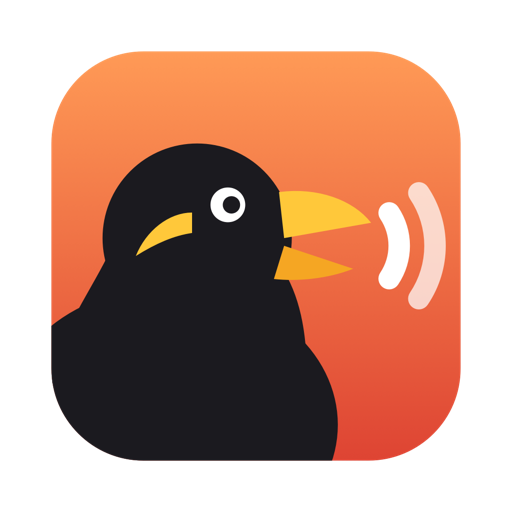
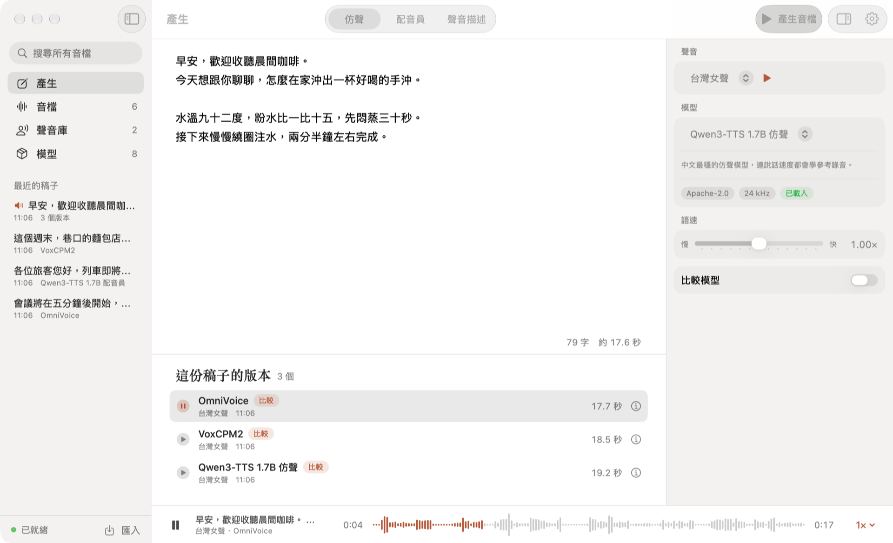
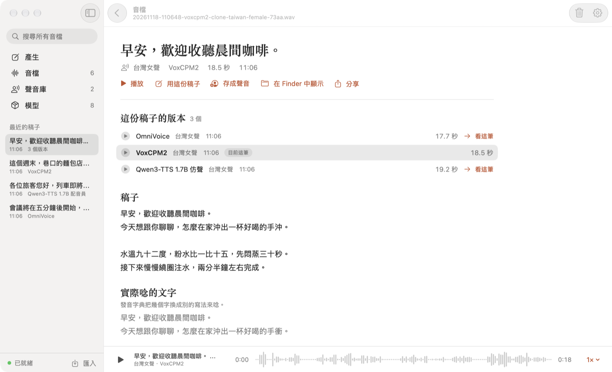
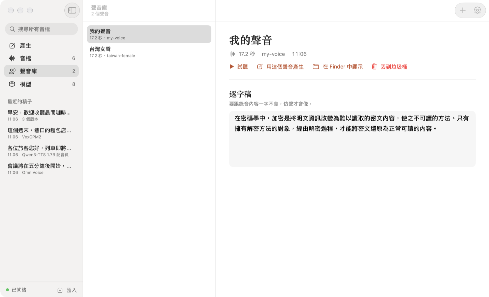
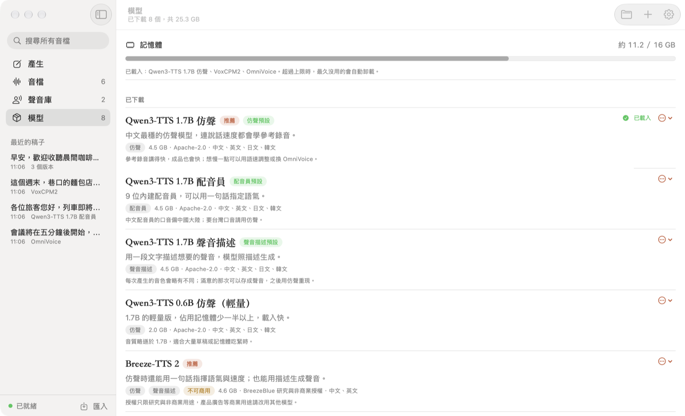

**繁體中文** | [English](.github/README.md) | 官網：[myna.weibuilds.com](https://myna.weibuilds.com)

# 九官鳥 Myna

macOS 的文字轉語音 app。寫好稿子，選一個聲音和模型，在你的 Mac 上唸成音檔。可以錄十秒自己的聲音讓它學，也可以用內建的配音員，或用一句話描述你要的聲音。

- 產生語音全程在本機，稿子、錄音、成品都不會上傳
- 內建 8 個開源語音模型的目錄，要用哪個自己挑、自己下載
- 同一份稿子可以一次交給幾個模型，做完排在一起比較
- 不用另外裝 Python，app 裡都帶了
- 需要 Apple Silicon 和 macOS 14 以上（我在 macOS 27 上開發和測試）



## 怎麼用

1. **下載模型**：第一次打開會列出推薦的模型，挑一個按下載。最小的 OmniVoice 是 1.6 GB。
2. **選聲音**：工具列中間切換三種方式。
   - 仿聲：到「聲音庫」錄 10 秒左右，照著畫面上那段字唸，之後就能用這個聲音唸任何稿子。
   - 配音員：模型內建的聲音，可以加一句語氣（例如「親切、清楚的車站廣播」）。
   - 聲音描述：用文字形容想要的聲音（例如「三十歲左右的台灣女性，聲音溫暖親切」）。
3. **寫稿子，按 ⌘↩**：換行會分段唸，空一行會停久一點。做完自動播放。
4. **比較**：在右邊打開「比較模型」勾幾個，同一份稿子會各產生一次，排在稿子下方。
5. **拿去用**：音檔可以直接拖到 Finder、剪輯軟體或聊天視窗。



## 功能

- **三種產生方式**：仿聲、配音員、聲音描述
- **聲音庫**：錄音或匯入音檔做成聲音，可以試聽、改名、改逐字稿。聲音跟模型分開，同一個聲音可以換模型試
- **把成品存成聲音**：聲音描述每次產生的音色都不太一樣，試到滿意的那次可以存進聲音庫，之後用仿聲重現
- **模型管理**：下載看得到進度、可以取消、下次會續傳；刪除、載入、卸載都在 app 裡做。記憶體超過上限時，最久沒用的模型會自動卸載
- **加入其他模型**：輸入 Hugging Face 上的模型名稱，可以加入同系列的其他版本（例如比較小的量化版）
- **長稿子**：自動分段，看得到做到第幾段，中途可以取消
- **發音字典**：模型唸錯的字詞，可以指定另一種寫法來唸，稿子不用改
- **語速**：OmniVoice 由模型自己控制語速；其他模型用變速不變調（要裝 ffmpeg）
- **音檔**：所有產生過的音檔都留著，可以搜尋、排序。刪除會進垃圾桶，⌘Z 可以復原
- **播放列**：有波形，可以點或拖曳跳轉，試聽可以調倍速
- **服務選單**：在任何 app 選一段字，右鍵 → 服務 →「用九官鳥唸出來」
- **讓 AI 工具產生語音（MCP）**：見下方



## 模型

模型不在 app 裡，是你在「模型」頁自己下載的，存在 Hugging Face 的快取資料夾。下表每個模型我都用同一句中文測過：產生之後用語音辨識轉回文字，算錯了幾個字。

| 模型 | 方式 | 大小 | 授權 | 錯字率 | 說明 |
|---|---|---|---|---|---|
| Qwen3-TTS 1.7B 仿聲 | 仿聲 | 4.5 GB | Apache-2.0 | 0% | 中文最穩，連說話速度都會學參考錄音 |
| Qwen3-TTS 1.7B 配音員 | 配音員 | 4.5 GB | Apache-2.0 | 0% | 9 位配音員，可以指定語氣；中文口音偏中國大陸 |
| Qwen3-TTS 1.7B 聲音描述 | 聲音描述 | 4.5 GB | Apache-2.0 | 0% | |
| Qwen3-TTS 0.6B 仿聲 | 仿聲 | 2.0 GB | Apache-2.0 | 0% | 輕量版，記憶體用量少一半以上 |
| Breeze-TTS 2 | 仿聲、聲音描述 | 4.6 GB | 研究與非商業 | 0% | 仿聲時可以用一句話指揮語氣；**不能商用** |
| VoxCPM2 | 仿聲、聲音描述 | 3.2 GB | Apache-2.0 | 0% | 48 kHz |
| OmniVoice | 仿聲、聲音描述 | 1.6 GB | Apache-2.0 | 0% | 最快，語速由模型自己控制 |
| MOSS-TTS Nano | 仿聲 | 0.4 GB | Apache-2.0 | 8% | 最小，適合試稿，不適合當成品 |

授權以各模型自己的頁面為準，要商用請自己再確認一次。app 裡不能商用的模型會標出來。



## 請只用你有權使用的聲音

仿聲很容易被拿來冒充別人。請只錄你自己的聲音，或已經取得對方同意的聲音。

## 讓 AI 工具產生語音（MCP）

九官鳥開著的時候，支援 MCP 的 AI 工具可以直接叫它唸稿。Claude Code 加這一行：

```bash
claude mcp add --transport http myna http://localhost:8790/mcp
```

其他工具把 `http://localhost:8790/mcp` 填進它的 MCP 設定。這個位址只綁在 `127.0.0.1`，只有這台 Mac 自己連得到。

工具有 `list_voices`、`list_models`、`synthesize`、`get_job`、`add_voice`、`list_recent`。AI 工具送來的工作會出現在 app 的佇列，做完的音檔也會留在「音檔」。

## 隱私

- 稿子、參考錄音、產生的音檔都存在 `~/Library/Application Support/VoiceStudio`
- 語音在本機產生，不會把稿子或聲音送到任何伺服器
- 只有下載模型時會連到 Hugging Face
- 沒有使用統計，也沒有帳號

## 安裝

到 [Releases](https://github.com/juinwei7/Myna/releases/latest) 下載 DMG，把九官鳥拖進「應用程式」。

我沒有 Apple 開發者帳號，app 沒有經過 Apple 簽章。第一次打開會被擋下來：

1. 打開九官鳥，跳出警告時按「完成」
2. 到「系統設定 → 隱私權與安全性」，往下找到九官鳥，按「強制打開」
3. 之後就能正常打開

## 從原始碼建置

需要 Xcode 的命令列工具（`xcode-select --install`）。

```bash
git clone https://github.com/juinwei7/Myna.git
cd Myna/mac
make app        # 產生 build/九官鳥.app，第一次會下載 Python 與套件，約 650 MB
make install    # 裝到 ~/Applications
```

`make app` 會自己下載一份可攜的 Python（[python-build-standalone](https://github.com/astral-sh/python-build-standalone)），照 `mac/requirements.lock` 裝好套件，一起包進 app。

## 開發

```bash
# 後端的測試：假的模型、暫存的資料夾，幾秒跑完
python3.11 -m venv .venv && .venv/bin/pip install -r mac/requirements.lock
.venv/bin/python -m unittest discover -s studio/tests -t .

# app 的測試，以及打包、啟動、結束的驗收
cd mac && make test
```

專案分兩塊：

- `studio/`：語音服務（Python、FastAPI、[mlx-audio](https://github.com/Blaizzy/mlx-audio)）。模型能做什麼寫在 `catalog.py`，各家模型的參數差異收在 `adapters.py`。要加一個新模型，多半是在目錄加一筆
- `mac/`：SwiftUI 的 app。它只是介面，產生語音的規則都在語音服務裡，app 和 MCP 走同一套

設計原則在 [`specs/constitution.md`](specs/constitution.md)，兩份規格（多模型引擎、app 介面）在 [`specs/`](specs/)。用真的模型跑測試、截圖驗收的做法寫在各份規格的 `acceptance.md`。

## 授權

程式碼是 [MIT](LICENSE)。app 裡帶的 Python 與套件的授權條款在 [`mac/Resources/ThirdPartyLicenses.txt`](mac/Resources/ThirdPartyLicenses.txt)。語音模型的授權各自不同，見上面的表。
